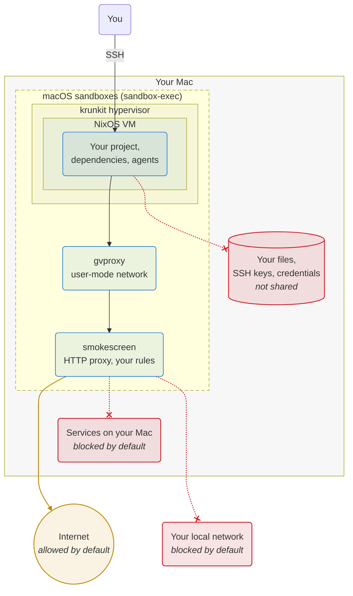

# devenv-sandbox-vm

Run coding agents and install dependencies in a sandboxed NixOS VM on your Mac. Declare the VM in
[devenv.sh](https://devenv.sh), next to the rest of your project.

> **Status:** experimental. Use it if you want to help test and develop it.

**Documentation: <https://jengdal.github.io/devenv-sandbox-vm/>**

## Why

On your Mac, a coding agent or a compromised dependency (a supply chain attack) runs as you. It can
read your SSH keys, your cloud credentials and all your repos, and send them anywhere.

In the VM, it gets only the files that you put there. All its connections go through an HTTP proxy
with your rules. By default, the proxy permits all hosts on the internet, and you can
[limit it to a list](https://jengdal.github.io/devenv-sandbox-vm/network.html#how-to-limit-the-destinations).
The VM is a long-lived workspace, so you can run your full project there: services, databases and
tests. If something breaks the VM, delete it and create a new one from the committed configuration.

## How it works



The VM has no shared directories and no route out other than the proxy and the ports that you open
in `devenv.nix`. The hypervisor, the network and the proxy run in macOS sandboxes. If an attacker
gets out of the VM, the sandbox limits what the attacker can do on the host. Refer to
[How it works](https://jengdal.github.io/devenv-sandbox-vm/how-it-works.html).

## What it looks like

You declare the VM in `devenv.nix`:

```nix
services.sandbox-vm = {
  enable = true;
  memory = 16; # GiB
  # Optional: the VM can connect only to these hosts.
  proxy.allowedDomains = [
    "cache.nixos.org"
    "*.cachix.org"
    "github.com"
    "*.github.com"
    "*.githubusercontent.com"
  ];
};
```

Then you start the VM and connect to it:

```bash
devenv up sandbox-vm
ssh devenv-<project>
```

To set it up, follow [Quick start](https://jengdal.github.io/devenv-sandbox-vm/quick-start.html).

## Features

- Declare the VM in the [devenv.sh](https://devenv.sh) of your project, or in a separate project.
- Work in the VM with a terminal editor, or with an editor on the host through SSH.
- Expose ports of the VM on the host.
- Let the VM connect to ports on other hosts.
- Make backups of the VM automatically (optional).
- The VM gives the memory that it does not use back to macOS. VMs on macOS usually do not do this.

You declare the VM with Nix in devenv, so you can extend it. For example, expose ports of the VM
with tools like `netbird expose`, `tailscale serve`, `ngrok` or `sish`, or let agents in the VM use
external services and MCP servers.

## Where to start

- [Quick start](https://jengdal.github.io/devenv-sandbox-vm/quick-start.html): the requirements and
  the steps to create a VM.
- [Security](https://jengdal.github.io/devenv-sandbox-vm/security.html): what an agent in the VM can
  and cannot do, and the limits of the sandbox.
- [Options](https://jengdal.github.io/devenv-sandbox-vm/reference/options.html): all settings of the
  VM.
- [Development](https://jengdal.github.io/devenv-sandbox-vm/development.html)

## Built on

[libkrun](https://github.com/libkrun/libkrun) and [krunkit](https://github.com/libkrun/krunkit),
[gvproxy](https://github.com/containers/gvisor-tap-vsock),
[smokescreen](https://github.com/stripe/smokescreen), [NixOS](https://nixos.org),
[devenv.sh](https://devenv.sh) and [BorgBackup](https://www.borgbackup.org). Refer to
[Credits](https://jengdal.github.io/devenv-sandbox-vm/introduction.html#credits).

## License

devenv-sandbox-vm is licensed under the [Apache License, Version 2.0](LICENSE). Some parts come from
other projects. [NOTICE](NOTICE) lists them.
